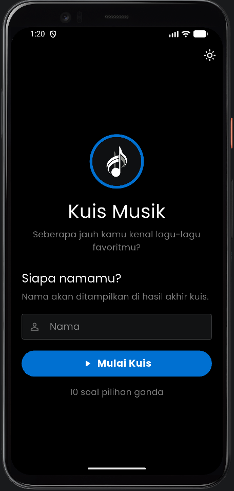
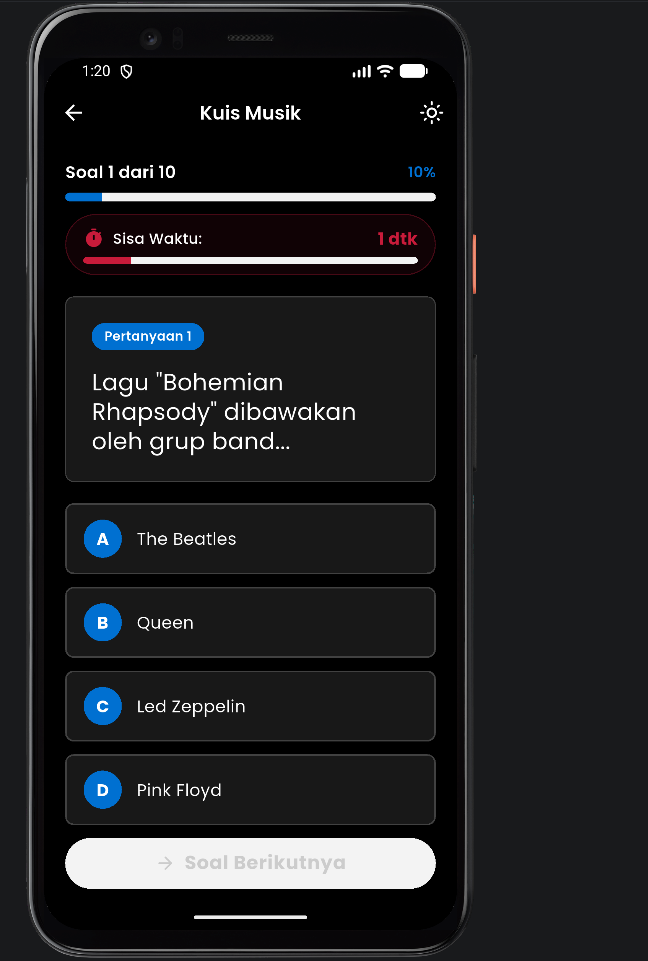
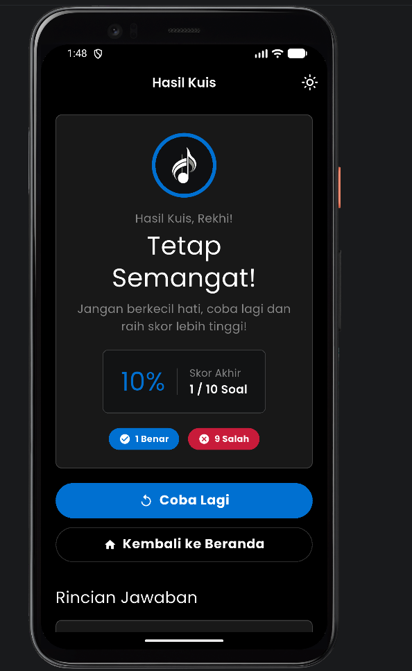

# Kuis Musik – Aplikasi Kuis Pilihan Ganda

---

## 👤 Identitas Mahasiswa

| Informasi | Keterangan |
|---|---|
| **Nama** | Rekhi Wirya Adjie |
| **NIM** | 241401099 |
| **Lab** | LAB 6 Pemrograman Mobile |

---

## 📱 Informasi Aplikasi

### Nama Aplikasi

**Kuis Musik** (`rekhi_uts`) – Kuis Pilihan Ganda Pengetahuan Musik

### Deskripsi Singkat

**Kuis Musik** adalah aplikasi kuis pilihan ganda berbasis Flutter yang dirancang untuk menguji wawasan pengguna mengenai dunia musik. Aplikasi ini dilengkapi dengan countdown timer selama 7 detik untuk setiap soal, logo musik, umpan balik jawaban secara langsung (*feedback banner*), statistik hasil kuis, dan rincian evaluasi jawaban.

Aplikasi ini mendukung tampilan responsif di berbagai ukuran layar, termasuk smartphone, tablet, dan web/desktop. Desain antarmuka menggunakan konsep PlayStation Design System dengan warna PlayStation Blue (`#0070D1`), tipografi ringan, tombol berbentuk Full Pill, serta dukungan Dark Mode dan Light Mode.

### Fitur-Fitur yang Tersedia

#### Fitur Wajib

- **Input Identitas Peserta** — Pengguna mengisi nama sebelum memulai kuis, dengan validasi minimal 2 karakter.
- **Kuis Pilihan Ganda** — Setiap sesi terdiri dari 5 soal pilihan ganda dengan opsi A–D bertema pengetahuan musik.
- **Timer 7 Detik per Soal** — Setiap soal memiliki batas waktu 7 detik. Jika waktu habis, soal dihitung salah.
- **Feedback Jawaban** — Jawaban benar, salah, atau waktu habis ditampilkan melalui umpan balik visual.
- **Hasil Akhir dan Rincian Jawaban** — Menampilkan skor, persentase akurasi, jumlah jawaban benar dan salah, serta evaluasi setiap soal beserta pembahasannya.

#### Fitur Tambahan

- **Logo Musik** — Menampilkan logo musik dari `app_logo.jpg` pada halaman awal dan halaman hasil kuis.
- **Dark Mode dan Light Mode** — Pengguna dapat beralih antara tema terang dan gelap menggunakan `ThemeProvider`.
- **PlayStation Design System** — Menggunakan warna PlayStation Blue (`#0070D1`), tipografi ringan, tombol Full Pill, dan kartu dengan sudut membulat.
- **Responsif Multi-Platform** — Tata letak menyesuaikan ukuran layar smartphone, tablet, dan web/desktop menggunakan helper responsivitas.
- **Animasi dan Umpan Balik Visual** — Memberikan animasi pada perubahan state, pemilihan jawaban, dan timer.

---

## 📂 Struktur Proyek

```text
lib/
├── data/
│   └── dummy_questions.dart
├── models/
│   └── question.dart
├── providers/
│   ├── quiz_provider.dart
│   └── theme_provider.dart
├── screens/
│   ├── home_screen.dart
│   ├── quiz_screen.dart
│   └── result_screen.dart
├── theme/
│   ├── app_colors.dart
│   └── app_theme.dart
├── utils/
│   └── responsive.dart
├── widgets/
│   ├── app_hero.dart
│   ├── custom_button.dart
│   ├── custom_text_field.dart
│   ├── feedback_banner.dart
│   ├── option_tile.dart
│   ├── question_card.dart
│   ├── question_review_list.dart
│   ├── quiz_progress_bar.dart
│   ├── quiz_timer_widget.dart
│   ├── responsive_container.dart
│   ├── result_summary_card.dart
│   └── theme_toggle_button.dart
└── main.dart
```

### Fungsi Folder dan File Utama

- `data/dummy_questions.dart` — Menyimpan data soal, pilihan jawaban, dan pembahasan.
- `models/question.dart` — Mendefinisikan model data pertanyaan dan jawaban benar.
- `providers/quiz_provider.dart` — Mengatur state kuis, skor, jawaban, dan timer.
- `providers/theme_provider.dart` — Mengatur tema terang dan gelap.
- `screens/home_screen.dart` — Menampilkan halaman awal dan input nama peserta.
- `screens/quiz_screen.dart` — Menampilkan soal, opsi jawaban, dan timer.
- `screens/result_screen.dart` — Menampilkan hasil dan evaluasi kuis.
- `theme/app_colors.dart` dan `theme/app_theme.dart` — Mengatur warna dan tema aplikasi.
- `utils/responsive.dart` — Membantu menyesuaikan tampilan dengan ukuran layar.
- Folder `widgets/` — Berisi komponen antarmuka yang digunakan kembali dalam aplikasi.
- `main.dart` — Menjadi titik awal aplikasi dan mengatur provider.

---

## 🚀 Cara Menjalankan Aplikasi

### Prasyarat

- Flutter SDK yang sesuai dengan kebutuhan proyek.
- Dart SDK yang kompatibel dengan versi Flutter.
- Emulator Android/iOS atau perangkat yang didukung.
- Browser Chrome jika ingin menjalankan aplikasi versi web.

### Langkah Menjalankan Aplikasi

1. Clone repository:

   ```bash
   git clone https://github.com/rekhiwirya/rekhi_uts.git
   ```

2. Masuk ke folder proyek:

   ```bash
   cd rekhi_uts
   ```

3. Unduh dependensi:

   ```bash
   flutter pub get
   ```

4. Jalankan aplikasi pada perangkat atau emulator:

   ```bash
   flutter run
   ```

5. Jika ingin menjalankan versi web menggunakan Chrome:

   ```bash
   flutter run -d chrome
   ```

---

## 🖼️ Screenshot Aplikasi

### Halaman Awal (Home Screen)



### Halaman Kuis (Quiz Screen)



### Halaman Hasil Kuis (Result Screen)



---

## 🎨 Dokumentasi

### Kredit Aset

| Aset | Sumber |
|---|---|
| Ikon dan Logo Musik | `assets/images/app_logo.jpg` |
| Font Poppins | [Google Fonts – Poppins](https://fonts.google.com/specimen/Poppins) |
| Ikon Material | [Material Symbols](https://fonts.google.com/icons) |
| Framework | [Flutter](https://flutter.dev) |
| State Management | [Provider](https://pub.dev/packages/provider) |

### Link Mockup / Prototype

[Canva Prototype Aplikasi](https://canva.link/01gg011iifz1bbd)

### Link Video Presentasi

[Google Drive – Video Presentasi](https://drive.google.com/drive/folders/1w0mBesn9ljGmOh4IerQuWQt2PYOXLm8f?usp=sharing)

---

## 🔄 Alur Kerja Aplikasi

```text
Halaman Awal (HomeScreen)
├── Isi nama peserta
├── Pilih tema (Dark / Light Mode)
└── Mulai Kuis
    └── Halaman Kuis (QuizScreen)
        ├── Countdown timer 7 detik per soal
        ├── Tampilkan pertanyaan dan pilihan A–D
        ├── Pilih jawaban atau tunggu waktu habis
        ├── Tampilkan feedback jawaban
        └── Lanjut ke soal berikutnya atau lihat hasil
            └── Halaman Hasil (ResultScreen)
                ├── Lihat skor dan persentase
                ├── Lihat rincian jawaban dan pembahasan
                └── Coba Lagi
```

---

## 🧰 Teknologi yang Digunakan

| Teknologi | Keterangan |
|---|---|
| **Flutter** | Framework untuk membangun antarmuka aplikasi lintas platform. |
| **Dart** | Bahasa pemrograman yang digunakan dalam pengembangan aplikasi. |
| **Provider** | Mengelola state kuis, skor, timer, dan tema. |
| **PlayStation Design System** | Acuan desain antarmuka dengan warna biru, tipografi ringan, dan tombol membulat. |
| **Responsive Helper** | Membantu menyesuaikan tata letak berdasarkan ukuran layar. |

---

*UTS Pemrograman Mobile – LAB 6 Pemrograman Mobile – Fasilkom-TI USU – 2026*
